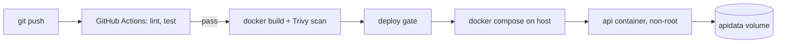

# Apex Operations API: DevOps Assessment

Small Flask API (`/health`, `/ready`, `/ops`, `/metrics`) with SQLite on a Docker volume, CI, versioned releases and rollback.

## Architecture


## Run (needs Docker, curl)
```bash
cp .env.example .env
./scripts/deploy.sh v1
curl localhost:8000/health && curl localhost:8000/ready
curl -X POST localhost:8000/ops -H 'Content-Type: application/json' -d '{"name":"check pump"}'
```
Tests locally with python pytest without docker: 
`python3 -m venv .venv`
`source .venv/bin/activate`
`pip install -r requirements.txt -r requirements-dev.txt && flake8 app tests && pytest -v`
`pytest -v`
`curl http://127.0.0.1:8000/health`
`curl http://127.0.0.1:8000/ready`
`curl -X POST http://127.0.0.1:8000/ops -H 'Content-Type: application/json' -d '{"name":"check pump"}'`
`curl http://127.0.0.1:8000/ops`

## Tests
8 automated checks always run, plus 1 intentional failure (`FORCE_FAIL=1 pytest` or run the CI workflow manually with `force_fail` ticked). A failing `test` job blocks `build` and `deploy` (`needs:`).

## Release and rollback (runbook)
- **Deploy:** `./scripts/deploy.sh v2` builds image `apex-ops-api:v2`, starts it, polls `/ready`. If not ready in ~40s it auto-rolls back.
- **Manual rollback:** `./scripts/rollback.sh` restarts the previously recorded image (`.previous_version`). Old images stay local, so no rebuild is needed. Data persists in the volume.
- **Verify:** `curl localhost:8000/health` shows the running `version`.

## Observability
- JSON logs to stdout: `docker compose logs -f api`
- Docker `HEALTHCHECK` and `/ready` (checks DB)
- `/metrics` exposes request and error counters.
- **Alert proposal (Prometheus):** error rate >5% for 5 min (page); `/ready` failing >2 min (page); container restarts >3 in 10 min (warn); disk >80% on data volume (warn).

### Failure investigation (do this, then paste real output as evidence)
1. Break it: `DB_PATH=/nonexistent/x.db docker compose up -d`
2. Symptom: `curl -i localhost:8000/ready` returns 503.
3. Investigate: `docker compose logs api | grep db_` shows `db_init_failed` / `db_unavailable` with the path.
4. Root cause: bad DB path. Fix: unset it, `docker compose up -d`; `/ready` returns 200.

## Security
- **Secrets:** none hard-coded. Config via env; `.env` is git-ignored; `.env.example` has placeholders. In cloud: secret manager, not env files.
- **Least privilege:** non-root user (uid 10001), `cap_drop: ALL`, `no-new-privileges`, read-only root FS, writable only `/data` and tmpfs `/tmp`. CI has no deploy credentials.
- **Scanning:** Trivy image scan in CI (report-only now; set `exit-code: 1` to block). Pinned dependency versions; suggest Dependabot.

## Cost-aware cloud path
Start on one small VM (or Fly.io/Render free-to-cheap tier) running the same compose file; push images to GHCR (free). Move to managed Postgres and a container service (ECS Fargate / Cloud Run) only when traffic or HA needs justify it.

## Decision memo (assumptions and trade-offs)
- SQLite on a volume instead of Postgres: simplest persistent storage; single-writer, not HA. Postgres is the next step.
- Compose over Kubernetes: right size for one service.
- "Deploy" job is a gate message because the assessment forbids paid cloud; real deploy is `deploy.sh`.
- Scan is non-blocking to avoid failing on base-image CVEs outside my control.
- Next with more time: Postgres, Prometheus + Grafana, image signing, blue/green.

## AI-use disclosure
**EDIT THIS before submitting.** Example: "I used Claude to draft the initial project scaffold, Dockerfile, CI workflow and README. I then ran, tested and modified everything myself and can explain each part."
I used claude for this project to write the api application and the rest of the files (scripts, ci workflow..), then as a DevOps Engineer I check all the files carefully and with the knowledge I have I edit the files as I see fit for the technical and business approach. then test the application locally without it being containerized then test it when it is containerized. finally I push the project to my github repo then check the ci workflow.

## Evidence checklist (add to /evidence)
-screenshot and video of api with health and ready shown<br>
-screenshot of green CI run; red CI run (force_fail);<br>
-screenshot of `docker compose ps`; deploy v1 then v2; rollback output; failure investigation logs.<br>
-a failure investigation solving video and screenshots<br>
